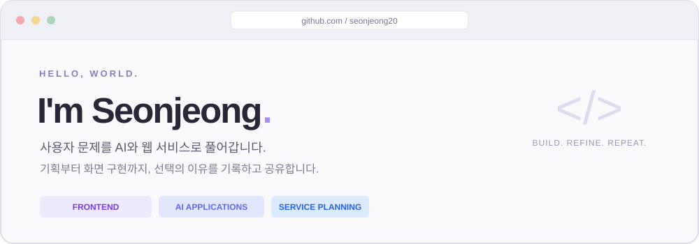
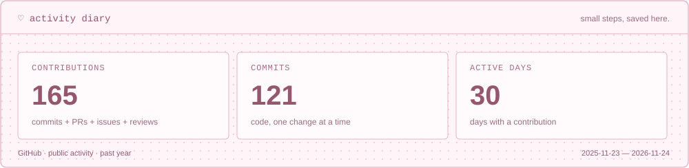

  

 

## ♡ 01 / toolbox

프로젝트와 학습에서 직접 활용한 기술입니다.

| | Technologies |
| :--- | :--- |
| **Frontend** |    |
| **Backend** |    |
| **Data & AI** |     |
| **Game & Tools** |     |

 

## ♡ 02 / project diary

| Project | Focus & Experience |
| :--- | :--- |
| **[AI Japanese Speaking](https://github.com/seonjeong20/ai-japanese-speaking)** | AI 일본어 회화·면접 학습 서비스. **React 화면과 STT·LLM·TTS 대화 흐름**을 구현하고, Spring Boot·Spring AI로 피드백과 학습 기록을 연결했습니다. B2C 전환을 위한 **문제 정의·경쟁 조사·PRD·설계 결정**도 문서화하고 있습니다. |
| **[InterviewBridge AI](https://github.com/seonjeong20/interviewbridge-ai)** | 글로벌 구직자를 위한 AI 면접 코칭 프로젝트. **React·Spring Boot·Python 기반 면접·평가·코칭 흐름**을 구현했습니다. AI 코딩 도구와 함께 평가 검증 실험을 진행하고, 개선 효과와 한계를 [검증 보고서](https://github.com/seonjeong20/interviewbridge-ai/blob/main/docs/ai-evaluation-validation-v2-report.md)에 기록했습니다. |
| **[KOSPI · 건강식품 지수 D+3 예측](https://github.com/seonjeong20/kospi-healthfood-d3-prediction)** | Python·pandas·scikit-learn을 활용한 **시계열 데이터 분석**. 가설별 실험과 시간 순서 검증을 거쳐 교육 과정 **3반 Private 리더보드 3위**를 기록했습니다. AI 코딩 도구를 활용했으며, 실험 방향과 최종 제출 모델은 직접 결정했습니다. |

 

## ♡ 03 / activity diary

  

GitHub 공식 데이터 · 최근 1년 공개 활동 · 6시간마다 갱신. 기여 수에는 커밋·PR·이슈·리뷰가 포함되며, 활동일은 기여가 있었던 날짜 수입니다. [활동 기록 보기 ♡](https://github.com/seonjeong20?tab=overview)
